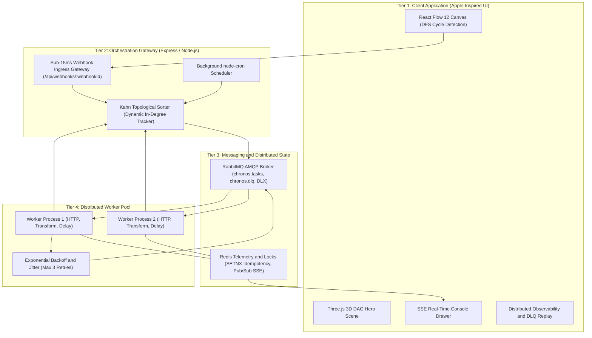

# 🌀 ChronosFlow — Distributed DAG Workflow & Automation Engine
> **PS-04: THE DORMAMMU LOOP**  
> **CodeSangam 2026 // MNNIT Allahabad**  
> **Team:** FLCN (Team ID: 272)  
> **Lead Developer:** Raghav Gupta (20243226 CSE)

[](https://opensource.org/licenses/MIT)
[](https://nodejs.org/)
[](https://www.rabbitmq.com/)
[](https://redis.io/)
[](https://developer.apple.com/design/)

---

## 📖 Executive Summary
In complex software architectures, asynchronous computations often become chaotic "temporal loops"—unobservable background scripts, cascading microservice failures, and infinite cycle deadlocks (*The Dormammu Loop*).

**ChronosFlow** is a distributed, event-driven Directed Acyclic Graph (DAG) orchestration engine. It enables developers and operations teams to visually construct distributed workflows, enforce mathematical acyclicity before task execution, ingest triggers in under 15ms into durable AMQP queues, coordinate distributed worker pools using Kahn's topological sort, and recover self-healing pipelines with exponential backoff and Dead-Letter Queue (DLQ) vaults.

Wrapped in an **Apple-inspired design philosophy**, ChronosFlow combines functional elegance with production-grade distributed systems engineering.

---

## 🏛️ 4-Tier Distributed System Architecture



### 1. Tier 1: Client Application (React & Three.js)
- **Apple Design Language:** Default light theme with subtle warm grays, SF Pro system typography, restrained corner radii, and high-contrast dark theme toggle.
- **Three.js Interactive 3D Hero Scene:** Studio-lit physical materials with glowing photons traveling between 3D nodes (Webhook → RabbitMQ → Workers → Redis → DLQ).
- **Client-Side DFS Cycle Detector:** Analyzes topology in real time on edge connection to block invalid cyclic loops (*Dormammu Loops*) before they reach the server.
- **Real-Time SSE Streaming Console:** Consumes execution events without polling, streaming logs, worker IDs, and durations into a collapsible terminal drawer.
- **Contextual Node Inspector:** Inspect node configs, test single nodes in isolation, update webhook paths, and view execution outputs.

### 2. Tier 2: Orchestration API Gateway (Express / Node.js)
- **Kahn's Deterministic Topological Sorter:** Computes exact execution stages and topological order in O(V + E) time complexity.
- **Dynamic In-Degree Dependency Tracker:** As upstream tasks complete, in-degrees of child nodes decrement; nodes unlock and dispatch to RabbitMQ only when all prerequisites reach 0.
- **Sub-15ms Ingestion:** External webhooks validate and offload into AMQP queues in under 15ms.

### 3. Tier 3: Messaging & Telemetry Layer (RabbitMQ & Redis)
- **RabbitMQ AMQP 0-9-1 (`amqplib`):** Message durability, `prefetch(5)` backpressure limits, explicit acknowledgments (`ACK`/`NACK`), and Dead-Letter Exchange (`chronos.dlx`).
- **Redis (`ioredis`):** Atomic distributed locks via `SETNX` to prevent double-execution, 5-second worker heartbeats, and Pub/Sub broadcasting for real-time SSE telemetry.
- **Zero-Dependency Fallback:** Automatically runs against live external RabbitMQ/Redis or transparently activates an embedded in-memory broker if Docker services are offline.

### 4. Tier 4: Distributed Worker Pool
- **Isolated Workers:** Autonomous background processes pulling tasks from `chronos.tasks`.
- **Fault-Tolerant Retry Protocol:** Exponential backoff with full random jitter:
  $$\text{Delay} = \min\left(\text{MaxDelay}, \text{BaseDelay} \times 2^{\text{attempt}-1}\right) + \text{jitter}$$
- **Dead-Letter Queue (DLQ):** Safely isolates tasks that fail 3 consecutive attempts without halting downstream healthy nodes.
- **1-Click DLQ Replay:** Observability dashboard allows re-enqueueing dead-lettered tasks back into RabbitMQ.

---

## 🧮 Mathematical Foundations & Algorithms

### 1. Kahn's Topological Sorting (O(V + E))
Used by the Orchestration Gateway to partition DAG nodes into parallel execution stages:
```
1. Compute in-degree (number of incoming directed edges) for every node.
2. Initialize Queue Q with all nodes having in-degree == 0 (Root Nodes).
3. While Q is not empty:
     a. Dequeue node U, append to Topological Order.
     b. For each downstream neighbor V of U:
          - Decrement in-degree(V).
          - If in-degree(V) == 0, enqueue V into next stage.
4. If topological order length != total nodes, a cycle exists.
```

### 2. Depth-First Search Cycle Detection (O(V + E))
Used in the UI to prevent closed loop creation in real time:
- When a user draws an edge from `Source` to `Target`, DFS checks if `Source` is already reachable from `Target`.
- If reachable, the edge is rejected and an alert toast is displayed: *"Dormammu Loop Detected: Cycle path Target → ... → Source."*

### 3. Exponential Backoff with Full Random Jitter
Prevents the **Thundering Herd** problem when an upstream microservice fails:
```javascript
const exponentialDelay = Math.min(maxDelayMs, baseDelayMs * Math.pow(2, attempt - 1));
const jitter = Math.floor(Math.random() * (exponentialDelay * 0.5));
const totalDelay = exponentialDelay + jitter;
```

---

## 🎯 5 Built-in Production Presets

| # | Preset Name | Nodes | Stages | Description |
| :-: | :--- | :-: | :-: | :--- |
| **01** | **The Dormammu Loop Breaker** | 4 | 4 | Core event pipeline: Webhook Ingress → 1.5s Debounce → Payload Normalizer → Payment Gateway HTTP. |
| **02** | **Fault-Tolerant Backoff & DLQ Demo** | 3 | 3 | Simulates an unstable HTTP service (503 Gateway). Demonstrates 3 retries with jitter before quarantining into the DLQ Vault. |
| **03** | **Diamond DAG Concurrency** | 4 | 3 | Asynchronous parallel execution: 1 Trigger splits into 2 concurrent branches running simultaneously and joining at an Aggregate node. |
| **04** | **Cron Scheduler & Health Sentinel** | 3 | 3 | Autonomous cron-driven pipeline firing every 20s (`*/20 * * * * *`), probing sentinel endpoints and updating metrics. |
| **05** | **Global Fintech & Order Clearing Matrix** | **14** | **8** | **Ultra-complex enterprise DAG**: Webhook Ingress → 3-Way Fan-out (Auth, Cart Normalization, Debounce) → 4 Concurrent Services (AML/KYC, Neural Risk Classifier, Avalara Tax, SKU Reservation) → 3-Parent Risk Join → Stripe Escrow Payment → Dual Post-Payment Fan-out (Crypto Invoice Signer + Logistics Queue Debounce) → FedEx/DHL Waybill Dispatch → Telemetry Audit Ledger Join. |

---

## 🛠️ REST API & Webhook Gateway Reference

### Ingress & Webhook Endpoints
- `POST /api/webhooks/:webhookId`  
  Ingests arbitrary JSON payloads in under 15ms. Matches against workflow nodes where `webhookPath == webhookId`.
  ```bash
  curl -X POST http://localhost:5000/api/webhooks/checkout-stream \
    -H "Content-Type: application/json" \
    -d "{\"orderId\":\"ORD-9999\",\"amount\":15000,\"currency\":\"USD\"}"
  ```

### Workflow & Execution Endpoints
- `GET /api/presets` — Returns all default presets plus custom user-created presets.
- `POST /api/presets` — Persists a new custom preset (Current Canvas or Starter).
- `DELETE /api/presets/:id` — Deletes a user custom preset from Redis and in-memory storage.
- `POST /api/workflows/:id/run` — Executes a workflow and returns Kahn's execution stages.
- `GET /api/executions/:id/stream` — Real-Time Server-Sent Events (SSE) log and status stream.
- `POST /api/workflows/validate` — Validates topology, checks for cycles, and returns stages.

### Observability & DLQ Endpoints
- `GET /api/health` — Returns system status, worker counts, and broker mode.
- `GET /api/dlq` — Fetches dead-lettered task records quarantined in the DLQ Vault.
- `POST /api/dlq/:id/replay` — Re-enqueues a dead-lettered task back into RabbitMQ.
- `GET /api/cron/jobs` — Lists active background cron schedules and registered triggers.

---

## 🚀 Quick Start Guide

### Prerequisites
- [Node.js](https://nodejs.org/) v18+ installed.
- (Optional) [Docker Desktop](https://www.docker.com/) for external RabbitMQ and Redis.

### Option 1: Instant Zero-Config Run (Embedded Broker)
ChronosFlow includes a self-contained embedded broker that runs out-of-the-box without requiring external Docker services:

```bash
# 1. Install dependencies for root and frontend
npm run install:all

# 2. Build the visual frontend
npm run build

# 3. Launch ChronosFlow Gateway & Background Worker
npm start
```
Open **[http://localhost:5000](http://localhost:5000)** in your browser!

---

### Option 2: Production Run with Live RabbitMQ & Redis
To run with live enterprise AMQP queues and Redis persistence:

```bash
# 1. Start RabbitMQ (with Web Management) and Redis containers
docker compose up -d

# 2. Install dependencies & build
npm run install:all
npm run build

# 3. Start ChronosFlow server
npm start
```

- **ChronosFlow Web App:** [http://localhost:5000](http://localhost:5000)
- **RabbitMQ Management Dashboard:** [http://localhost:15672](http://localhost:15672) (User: `guest`, Password: `guest`)
- **Redis Server:** `localhost:6379`

---

## 🧪 Algorithmic Verification Suite
Run the mathematical test suite verifying Kahn's Algorithm, DFS Cycle Detection, and Exponential Backoff with Jitter:

```bash
npm run test:algo
```

Output:
```
🧪 Testing ChronosFlow Core Algorithmic Engine...
✅ Test 1 Passed: Linear Topological Sort (A -> B -> C): [ 'A', 'B', 'C' ]
✅ Test 2 Passed: Diamond DAG Kahn Sort Stages: [ [ 'A' ], [ 'B', 'C' ], [ 'D' ] ]
✅ Test 3 Passed: Dormammu Cycle Detected by DFS: [ 'A', 'B', 'C', 'A' ]
✅ Test 4 Passed: Real-time UI edge connection blocker verified.
✅ Test 5 Passed: Exponential Backoff with Jitter for attempts 1-4: [ 1000, 1346, 1610, 3488 ]

🎉 ALL ALGORITHMIC TESTS PASSED PERFECTLY!
```

---

## 👥 Hackathon Credentials
- **Competition:** CodeSangam 2026 // MNNIT Allahabad
- **Problem Statement:** PS-04: The Dormammu Loop — Distributed DAG Workflow & Automation Engine
- **Team:** FLCN (Team ID: 272)
- **Lead Developer:** Raghav Gupta (20243226 CSE)
